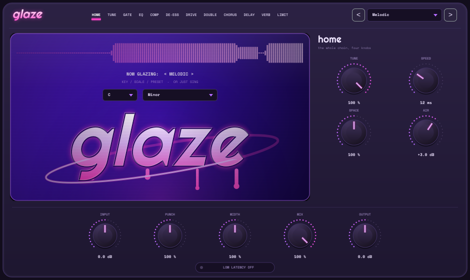
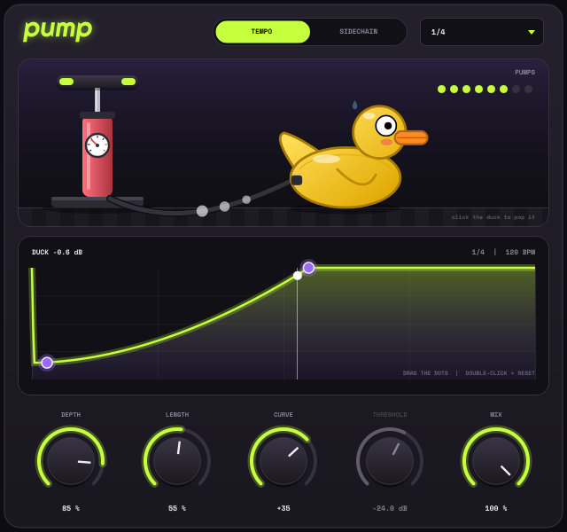

# glaze

A one-window vocal chain plugin (VST3 / AU / Standalone) built with JUCE.



**Chain:** Input → Gate → **Tune** → EQ → Comp → De-ess → Drive → Double → Chorus → Delay → Verb → Limiter → Output

| Module | What it does |
|---|---|
| **Home** | Key + scale, preset, and macro knobs: Tune, Speed, Space (verb + delay), Air, Punch (comp), Width (doubler), Mix, In/Out |
| **Tune** | Real-time pitch correction: YIN pitch detection + formant-preserving PSOLA. Retune speed (0 ms = hard tune), amount, humanize (keeps vibrato), formant shift, transpose, 7 scales. Live pitch graph. |
| **Gate** | Threshold / range / attack / release with hold |
| **EQ** | Low cut (24 dB/oct), body bell, presence bell, air shelf. Drag the dots on the analyser. |
| **Comp** | Soft-knee compressor with makeup + parallel mix |
| **De-ess** | Split-band de-esser (Linkwitz-Riley), drag the sibilance band |
| **Drive** | Asymmetric soft saturation with tilt tone |
| **Double** | Two detuned, modulated voices panned L/R |
| **Chorus** | Stereo quadrature chorus |
| **Delay** | Tempo-synced or free, ping-pong, filtered feedback |
| **Verb** | Plate-ish reverb with pre-delay, damping, low cut, width |
| **Limit** | Look-ahead peak limiter with ceiling |

7 factory presets: Melodic, Hard Tune, Clean R&B, Radio Lead, Ethereal, Lo-Fi Phone, Dry Clean.

## Get the Mac build

Every push to `main` builds a universal (Apple Silicon + Intel) VST3 + AU on GitHub Actions.
Go to **Actions → latest run → Artifacts → Glaze-mac**, unzip, run `Install Glaze.command`.
Push a tag like `v1.0.0` to also publish it as a GitHub Release.

## Build locally

```bash
cmake -B build -G Ninja -DCMAKE_BUILD_TYPE=Release   # JUCE 8 is fetched automatically
cmake --build build
```

Tests (pitch accuracy, transparency, presets) + UI snapshots:

```bash
cmake -B build-test -DGLAZE_BUILD_TESTS=ON -DCMAKE_BUILD_TYPE=Release && cmake --build build-test
./build-test/GlazeTest_artefacts/Release/GlazeTest
```

Latency: ~40 ms (reported to the host, so it's compensated). Toggle **Low Latency** for ~27 ms when tracking live.

Fonts: Righteous and Space Mono, SIL Open Font License (see `Resources/`).

---

# pump

Simple sidechain / volume-ducking plugin (VST3 / AU), in `pump/`.



- **Tempo** mode: tempo-synced duck (1/16 to 2 bars), locked to the DAW grid. No routing.
- **Sidechain** mode: triggered by a kick on the sidechain input, with threshold.
- Depth, Length, Curve, Threshold, Mix. Drag the dots on the curve. Click-free.
- A floor pump slams down on every duck and inflates a rubber duck; 8 pumps and it **pops**. Click the duck to pop it early.

Built and shipped by the same GitHub Actions workflow; it's inside the same `Glaze-mac` zip.
